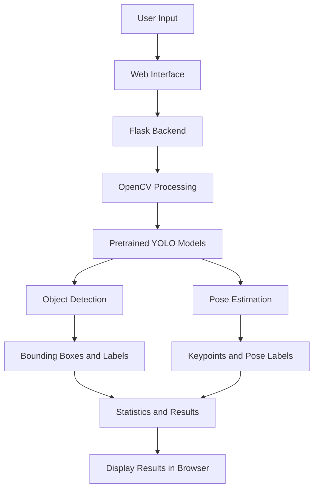
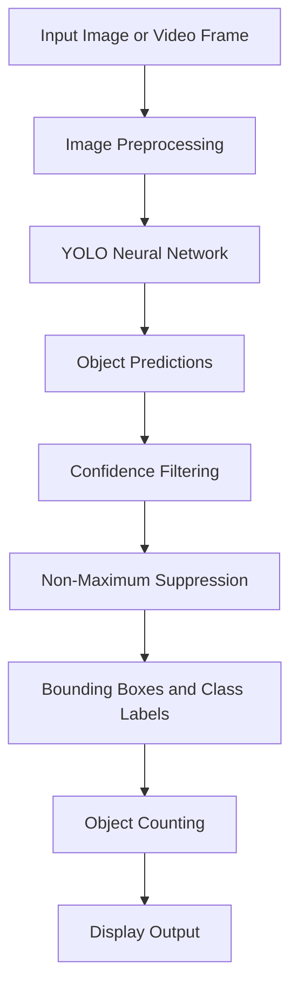

# 🔍 Real-Time Object Detection and Counting Using YOLO

<p align="center">
  
  
  
  
  
</p>

<p align="center">
  A real-time computer vision application for object detection, object counting, and human pose estimation using pretrained YOLO models.
</p>

---

## 📌 Table of Contents

- [Project Overview](#-project-overview)
- [Key Features](#-key-features)
- [Project Demo](#-project-demo)
- [Screenshots](#-screenshots)
- [Technologies Used](#-technologies-used)
- [System Architecture](#-system-architecture)
- [How YOLO Works](#-how-yolo-works)
- [Installation](#-installation-and-setup)
- [How to Run](#-how-to-run-the-project)
- [How to Use](#-how-to-use-the-application)
- [Project Structure](#-project-structure)
- [Future Improvements](#-future-improvements)
- [Limitations](#-limitations)

## 🚀 Project Overview

Real-Time Object Detection and Counting Using YOLO is a beginner-friendly deep learning mini-project that demonstrates how pretrained YOLO models can be integrated into a web application.

The application processes live webcam feeds, uploaded images, and uploaded videos. It identifies objects, draws bounding boxes, displays class labels and confidence scores, and calculates object counts by category.

It also includes human pose estimation in webcam mode to identify approximate poses such as:

- Hands Raised
- Arms Spread
- Crouching

The application combines deep learning, computer vision, backend development, and frontend technologies to provide an interactive object detection experience.

## ✨ Key Features

| Feature | Description |
|---|---|
| 📷 Real-Time Detection | Detect objects through a live webcam feed |
| 🖼️ Image Detection | Upload images and visualize detected objects |
| 🎥 Video Detection | Process uploaded videos frame by frame |
| 🧍 Pose Estimation | Estimate human body keypoints and selected poses |
| 📦 Bounding Boxes | Highlight detected objects with rectangles |
| 🏷️ Object Labels | Display predicted class names |
| 📊 Object Counting | Calculate class-wise detection counts |
| ⚡ FPS Display | Show the estimated processing speed |
| 📱 Responsive UI | Interactive and clean web interface |
| ⚠️ Error Handling | Handle invalid files and unsupported formats |

## 🎬 Project Demo

The following section is reserved for a short demonstration of the application.

<!-- Add your recorded demo GIF at docs/images/demo.gif and uncomment the next line -->

<!--  -->

**Demo highlights:**
- Real-time webcam object detection
- Bounding boxes and confidence scores
- Live object counting
- Human pose estimation
- Image and video processing

For a full-length demonstration, you can also add a link to your YouTube video here.

## 📸 Screenshots

The following screenshots will demonstrate the application's main functionalities.

### 1. Application Dashboard

<!-- Add dashboard.png to docs/images and uncomment -->

<!--  -->

### 2. Real-Time Webcam Detection

<!-- Add webcam-detection.png to docs/images and uncomment -->

<!--  -->

### 3. Human Pose Estimation

<!-- Add pose-estimation.png to docs/images and uncomment -->

<!--  -->

### 4. Image Detection Output

<!-- Add image-detection.png to docs/images and uncomment -->

<!--  -->

### 5. Video Detection Output

<!-- Add video-detection.png to docs/images and uncomment -->

<!--  -->

## 🛠️ Technologies Used

| Technology | Purpose |
|---|---|
| Python 3.12 | Backend programming |
| Flask | Web application framework |
| Ultralytics YOLO | Object detection and pose estimation |
| YOLOv8n | Pretrained object detection model |
| YOLOv8n-Pose | Human pose estimation model |
| OpenCV | Image and video processing |
| NumPy | Numerical operations |
| HTML5 | Frontend structure |
| CSS3 | Frontend styling |
| JavaScript | Frontend interactions |
| Bootstrap | Optional UI framework |

## 🏗️ System Architecture

The application follows a client-server architecture.



### Architecture Components

**1. Presentation Layer**
- HTML provides the application structure.
- CSS handles styling and layout.
- JavaScript manages user interactions and results.

**2. Backend Layer**
- Flask handles HTTP requests.
- Processes uploaded files.
- Manages application routes and responses.

**3. Computer Vision Layer**
- OpenCV captures webcam frames.
- Reads uploaded images and videos.
- Draws bounding boxes and annotations.

**4. Deep Learning Layer**
- Ultralytics YOLO performs object detection.
- YOLOv8 Pose estimates human body keypoints.
- Detection results are processed and displayed.

## 🧠 How YOLO Works

YOLO stands for **You Only Look Once**.

It is an object detection algorithm that predicts object locations and classes in a single neural network inference pass.

### Object Detection Pipeline



### Important YOLO Concepts

- **Bounding Box:** A rectangle representing the location of a detected object.
- **Class Label:** The predicted category of an object.
- **Confidence Score:** The model's confidence score for a detection.
- **IoU:** Intersection over Union, used to measure the overlap between bounding boxes.
- **NMS:** Non-Maximum Suppression, used to remove duplicate overlapping detections.
- **Inference:** Using an already-trained model to make predictions.

### Model Configuration

| Parameter | Value |
|---|---|
| Object Detection Model | YOLOv8n |
| Pose Estimation Model | YOLOv8n-Pose |
| Confidence Threshold | 0.25 |
| IoU Threshold | 0.45 |
| Image Size | 640 |

## ⚙️ Installation and Setup

### Prerequisites

Make sure you have installed:

- Python 3.12
- Git
- Visual Studio Code (recommended)
- A webcam (for real-time detection)

### Step 1: Clone the Repository

```bash
git clone https://github.com/yashgatkal22/DL-Miniproject.git
```

### Step 2: Navigate to the Project Folder

```bash
cd DL-Miniproject
```

### Step 3: Create a Virtual Environment

```bash
python -m venv .venv
```

### Step 4: Activate the Environment

For Windows:

```bash
.venv\Scripts\activate
```

### Step 5: Install Dependencies

```bash
pip install -r requirements.txt
```

## ▶️ How to Run the Project

Run the following command:

```bash
python app.py
```

Open your browser and navigate to:

```text
http://127.0.0.1:5000/
```

The application dashboard will open.

## 💻 How to Use the Application

### 1. Webcam Detection

1. Open the application dashboard.
2. Click the Start Camera button.
3. Allow camera access if prompted.
4. View real-time object detection.
5. Monitor object counts, confidence scores, FPS, and pose labels.
6. Click Stop Camera to stop the detection.

### 2. Image Detection

1. Open the Upload Image section.
2. Select an image file.
3. Click Process Image.
4. View the processed image with bounding boxes and labels.
5. Check the detection statistics.

### 3. Video Detection

1. Open the video upload section.
2. Select a video file.
3. Click Process Video.
4. The application processes the video frame by frame.
5. View the processed output video and detection statistics.

## 📁 Project Structure

```text
DL-Miniproject/
│
├── app.py
├── requirements.txt
├── test_app.py
├── README.md
├── .gitignore
│
├── yolov8n.pt
├── yolov8n-pose.pt
│
├── templates/
│   └── index.html
│
├── static/
│   ├── css/
│   └── js/
│
└── docs/
    └── images/
        ├── dashboard.png
        ├── webcam-detection.png
        ├── pose-estimation.png
        ├── image-detection.png
        ├── video-detection.png
        └── demo.gif
```

*The images folder and its files are to be added for the README screenshots and demo.*

## 🔮 Future Improvements

- Add custom YOLO model selection.
- Implement object tracking for unique object counting.
- Add multi-camera support.
- Improve pose classification accuracy.
- Add count summaries over time intervals.
- Develop an advanced analytics dashboard.
- Deploy the application on a cloud platform.

## ⚠️ Limitations

- The project uses pretrained models and does not include custom model training.
- Pose labels are estimated using body keypoints and simple geometric rules.
- Pose estimation may reduce FPS when running alongside object detection.
- Video counts represent detections across processed frames, not unique tracked objects.
- Detection performance depends on lighting, image quality, hardware, and object visibility.

## 🎓 Learning Outcomes

Through this project, the following concepts were explored:

- Deep learning and pretrained YOLO models.
- Real-time object detection.
- Human pose estimation.
- Image and video processing using OpenCV.
- Flask backend development.
- Frontend and backend integration.
- Building interactive computer vision applications.

## 👨‍💻 Author

**Yash Gatkal**

B.Tech Computer Engineering

[GitHub Profile](https://github.com/yashgatkal22)

---

<p align="center">
  ⭐ If you find this project interesting, consider giving the repository a star!
</p>
