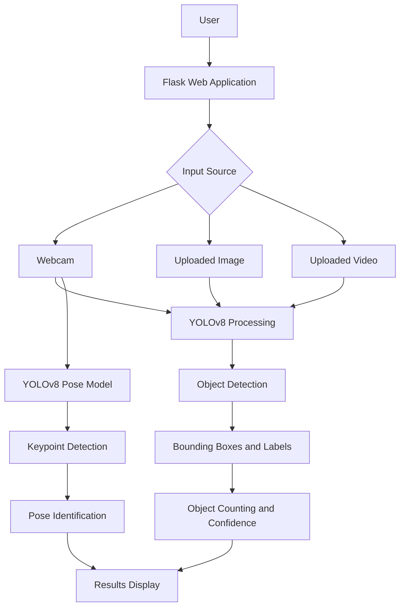

# Real-Time Object Detection and Counting Using YOLO


## Table of Contents

- [Overview](#overview)
- [Features](#features)
- [Technologies Used](#technologies-used)
- [System Architecture](#system-architecture)
- [How It Works](#how-it-works)
- [Project Structure](#project-structure)
- [Installation and Setup](#installation-and-setup)
- [Usage](#usage)
- [Models Used](#models-used)
- [Limitations](#limitations)
- [Future Improvements](#future-improvements)
- [Learning Outcomes](#learning-outcomes)
  

## Overview

This project is a real-time object detection and counting system developed using **YOLOv8, OpenCV, and Flask**.

It uses a pretrained YOLO model to identify and count objects from webcam streams, uploaded images, and uploaded videos. The application displays detected objects with bounding boxes, class labels, confidence scores, and object counts.

The webcam module also includes basic human pose estimation to identify selected body movements using a pretrained YOLO pose model.

The project provides a simple web-based interface for exploring real-time object detection and computer vision applications.

## Features

| Feature | Description |
|---|---|
| Real-Time Webcam Detection | Detects objects directly through a webcam. |
| Image Detection | Detects and identifies objects in uploaded images. |
| Video Detection | Processes uploaded videos and detects objects across frames. |
| Object Counting | Displays class-wise and total detection counts. |
| Bounding Boxes | Highlights detected objects with rectangular bounding boxes. |
| Confidence Scores | Displays the confidence score for each detection. |
| FPS Display | Shows the processing frame rate during detection. |
| Human Pose Estimation | Identifies selected body movements using pose keypoints. |

### Human Pose Estimation

The webcam module uses a pretrained YOLOv8 pose model to identify human body keypoints.

Based on the detected keypoints and simple geometric rules, the application identifies selected movements:

- Hands Raised
- Arms Spread
- Crouching

## Technologies Used

| Technology | Purpose |
|---|---|
| Python | Main programming language |
| Flask | Backend web framework |
| Ultralytics YOLOv8 | Object detection and pose estimation |
| OpenCV | Image and video processing |
| NumPy | Numerical operations |
| HTML5 | Web page structure |
| CSS3 | Styling and layout |
| JavaScript | Frontend interactions |
| Bootstrap | Optional responsive UI components |

## System Architecture

The application follows a simple web-based architecture.



## How It Works

The application processes input through the following steps:

1. **Input Selection:** The user selects webcam detection, image upload, or video upload.
2. **Frame Processing:** OpenCV reads the image or video frames.
3. **Object Detection:** The pretrained YOLOv8 model identifies objects.
4. **Bounding Box Generation:** Detected objects are highlighted with bounding boxes and labels.
5. **Object Counting:** The application calculates class-wise and total detection counts.
6. **Result Display:** The processed output and detection information are displayed through the Flask web application.
7. **Pose Estimation:** In webcam mode, the YOLOv8 pose model detects body keypoints and applies geometric rules to identify selected movements.

## Project Structure

```text
DL-Miniproject/
│
├── app.py
├── requirements.txt
├── test_app.py
├── .gitignore
│
├── yolov8n.pt
├── yolov8n-pose.pt
│
├── templates/
│   └── index.html
│
├── static/
│   ├── css/
│   │   └── style.css
│   │
│   └── js/
│       └── script.js
│
└── docs/
```

## Installation and Setup

Follow these steps to run the project locally.

### 1. Clone the Repository

```bash
git clone https://github.com/yashgatkal22/DL-Miniproject.git
```

### 2. Navigate to the Project Directory

```bash
cd DL-Miniproject
```

### 3. Create a Virtual Environment (Optional)

```bash
python -m venv venv
```

Activate the environment:

**Windows:**

```bash
venv\Scripts\activate
```

**Linux / macOS:**

```bash
source venv/bin/activate
```

### 4. Install Dependencies

```bash
pip install -r requirements.txt
```

### 5. Run the Application

```bash
python app.py
```

### 6. Open in Browser

Open the following URL in your browser:

```text
http://127.0.0.1:5000/
```

## Usage

1. Start the Flask application.
2. Open the application in your browser.
3. Select the required detection option.
4. For webcam detection, allow camera access.
5. For image or video detection, upload the required file.
6. View the processed output, detected objects, confidence scores, and object counts.

## Models Used

### 1. YOLOv8 Object Detection Model

**Model:** `yolov8n.pt`

The pretrained YOLOv8 Nano model is used for detecting and identifying objects in webcam streams, images, and videos.

### 2. YOLOv8 Pose Estimation Model

**Model:** `yolov8n-pose.pt`

The pretrained YOLOv8 Nano Pose model is used in webcam mode to detect human body keypoints. These keypoints are used with simple geometric rules to identify selected body movements.

## Limitations

- Detection accuracy depends on image quality, lighting conditions, and object visibility.
- Processing performance depends on the available hardware.
- Pose estimation may be affected by camera angle, body visibility, and overlapping people.
- Pose identification uses basic geometric rules rather than a separately trained activity classification model.
- Video object counts represent accumulated detections across frames and are not unique tracked-object counts.

## Future Improvements

- Implement object tracking to maintain object identities across video frames.
- Improve object counting accuracy by avoiding repeated counts across frames.
- Enhance pose estimation for more body movements.
- Optimize processing performance for smoother real-time detection.
- Improve the user interface and overall application experience.

## Learning Outcomes

Through this project, we explored:

- Practical implementation of pretrained YOLO models.
- Real-time object detection using computer vision.
- Image and video processing using OpenCV.
- Integration of machine learning models with Flask.
- Object counting and confidence score visualization.
- Human pose estimation using body keypoints.
- Development of a web-based deep learning application.


B.Tech Computer Engineering

GitHub: [yashgatkal22](https://github.com/yashgatkal22)

---

If you find this project useful, consider giving the repository a ⭐ on GitHub.
